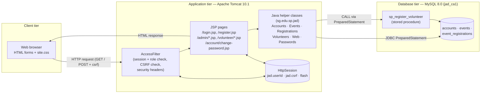
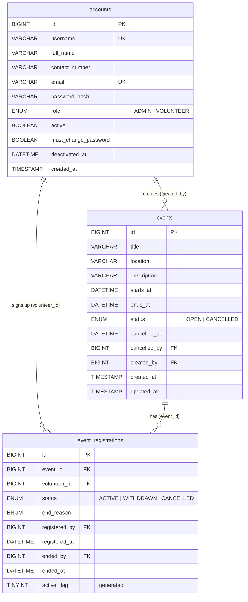

# Vision Screening Station Management System — Technical Document

ST0510 J2EE Application Development · Assignment 1 · AY2026/27 S2

| | |
| --- | --- |
| Team | Aarya (Admin features: events, participant administration, event sign-ups, Admin-created accounts) · Zhuo Xiang (foundation: project setup, authentication, sessions, public registration; participant self-service) |
| Repository | https://github.com/TingZhuoXiang/JAD-CA1 |
| Stack | JDK 17+ (built with JDK 25/26), Jakarta EE 10 web profile (Servlet 6.0, JSP 3.1) on Apache Tomcat 10.1 / TomEE 10, MySQL 8.0 via JDBC (Connector/J) |
| Status | Phase 2 (Admin) and Phase 3 (Volunteer self-service) implemented. |

**Terminology.** The brief's *participant* is the person attending a screening; the code and pages call this
account role `VOLUNTEER` (shown as "Volunteer", ID format `V-<n>`). *Admin* is the staff role. An *event
registration* (sign-up) links an existing participant account to one event.

---

## 1. Architecture

The application is a **three-tier** Java EE web application: the browser is the presentation client, Tomcat
runs the JSP pages and Java helper classes (application tier), and MySQL stores the data (database tier). It
is deliberately not a formal MVC application (brief 4.5); instead, all SQL lives in plain Java classes that
the JSP pages call, so a feature can be moved behind a servlet controller in Assignment 2 without rewriting
its data access.



Text version (for print): `Browser ⇄ HTTP ⇄ [Tomcat: AccessFilter → JSP page → Java helper class] ⇄ JDBC ⇄ [MySQL: tables + stored procedure]`

**Request flow, e.g. an Admin adds a participant to an event**

1. The browser POSTs `admin/event.jsp` with `action=register`, `volunteerId` and the hidden `csrf` token.
2. `AccessFilter` reads `jad.userId` from the `HttpSession`, re-loads the account (must be active and `ADMIN`),
   checks the CSRF token, and exposes the account as the `currentUser` request attribute.
3. `event.jsp` calls `Registrations.register(eventId, volunteerId, adminId)`, which runs
   `CALL sp_register_volunteer(?, ?, ?, ?)` through a `PreparedStatement`.
4. The procedure locks the event and account rows, applies the sign-up rules, and inserts the row or raises
   `SQLSTATE 45000` with a reason. The page shows the reason, or stores a success message in the session and
   redirects (POST-redirect-GET) back to the event page.

### Project layout

```
Code/JAD-CA1/
├── database/setup.sql            schema, stored procedure, demo seed (re-runnable)
├── docs/technical-document.md    this document
├── tests/admin-tests.sh          end-to-end test script (curl + mysql)
└── src/main/
    ├── java/sg/edu/sp/jad/       AccessFilter, Accounts, Events, Registrations, Volunteers, Web, Passwords, BootstrapAdmin
    └── webapp/
        ├── index.jsp, login.jsp, logout.jsp, register.jsp, site.css
        ├── admin/                Admin pages (Admin role only)
        ├── volunteer/            participant pages (Volunteer role only)
        ├── account/              pages for any signed-in user (change password)
        ├── WEB-INF/web.xml       filter mapping, session timeout (20 min), cookie settings
        ├── WEB-INF/jspf/         shared JSP fragments (Admin header)
        └── META-INF/context.xml  SameSite cookie setting
```

---

## 2. Database design



| Table | Purpose and key rules |
| --- | --- |
| `accounts` | One row per user. `role` is `ADMIN` or `VOLUNTEER` (participant); public registration always creates `VOLUNTEER`. The participant ID shown to users is `V-` + `id` (generated by `AUTO_INCREMENT`, unique, never reused). Passwords are stored only as PBKDF2-SHA256 hashes (600,000 iterations, random salt). `active = FALSE` blocks sign-in; `must_change_password` forces a new password after an Admin creates the account. |
| `events` | Screening events. `starts_at`/`ends_at` hold Singapore local time; `CHECK (ends_at > starts_at)`. Stored `status` is `OPEN` or `CANCELLED`; the displayed status (Upcoming / In progress / Completed / Cancelled) is derived from the dates. |
| `event_registrations` | Associates a participant with an event (brief 3.3). Ending a sign-up changes its status instead of deleting it; re-joining inserts a new row, so the rows are the sign-up history. `active_flag` is `1` for `ACTIVE` rows and `NULL` otherwise, and `UNIQUE (event_id, volunteer_id, active_flag)` allows **at most one active sign-up per participant per event** while keeping any number of ended rows. `CHECK` keeps `end_reason` set exactly when the row is not active. |

**Integrity.** Foreign keys connect every sign-up to an existing event and account; there are no cascading
deletes, so deleting an event explicitly removes its sign-ups first in the same transaction. Multi-row changes
(cancel event, deactivate participant, delete event) run in one JDBC transaction with row locks.

**Stored routine — `sp_register_volunteer(p_event_id, p_volunteer_id, p_actor_id, p_now)`.** The single rule
for creating a sign-up, used by both the Admin roster and participant self-service. It runs in a transaction,
locks the event and account rows (`SELECT … FOR UPDATE`), and rejects with `SQLSTATE 45000` if the event does not
exist, is cancelled, or has started; if the account is not an active participant; or if an active sign-up
already exists. The unique key is a second guard against double submission.

**Time.** Business rules use the application clock `Events.now()` (Asia/Singapore), passed into SQL as a
parameter, so they never depend on the MySQL server's time zone.

---

## 3. Requirements traceability (brief → implementation)

| Brief | Requirement | Where it is implemented |
| --- | --- | --- |
| 3.1 | Login and logout | `login.jsp` (`Accounts.authenticate`), `logout.jsp` (POST only, `session.invalidate()`) |
| 3.1 | Authenticated state in `HttpSession` | `Web.signIn` stores `jad.userId`; a new session ID is issued at sign-in |
| 3.1 | Block unauthenticated access to restricted pages | `AccessFilter` guards `/admin/*`, `/volunteer/*`, `/account/*`; wrong role → 403 |
| 3.1 | Visible user context (name and role) | Admin header (`WEB-INF/jspf/admin-nav.jspf`), dashboard, volunteer page |
| 3.1 | Session expiry / invalid session → login with a message | `web.xml` 20-minute timeout; `AccessFilter` invalidates and redirects to `login.jsp?notice=signin` ("Your previous session may have expired") |
| 3.2 | Register a participant with particulars | `register.jsp` (self-service) and `admin/volunteer-new.jsp` (Admin) — username, full name, contact number, email |
| 3.2 | Unique participant identifier, stored | `accounts.id` (`AUTO_INCREMENT`), shown as `V-<id>` |
| 3.2 | Validate mandatory data before writing | `Accounts.validateNewAccount` / `validateProfile` / `validatePassword`; unique keys on username and email |
| 3.2 | Searchable / filterable participant list | `admin/volunteers.jsp` — search name, username, email, phone or `V-<id>`; filter Active / Deactivated / All |
| 3.2 | View and update a participant | `admin/volunteer.jsp` (details, sign-up history, edit name/phone/email) |
| 3.2 | Deactivate only after confirmation | `admin/volunteer-deactivate.jsp` → `Volunteers.deactivate` (transaction: block login, cancel upcoming sign-ups, keep history) |
| 3.2 | Success and error messages | Flash messages after every successful POST; form-level and field-level errors; 4xx/503 status codes |
| 3.3 | Create an event (name, date, status) | `admin/event-form.jsp` → `Events.create`; status shown on every event page |
| 3.3 | Display events and details | `admin/events.jsp` (search + filter Upcoming / Past / Cancelled / All), `admin/event.jsp` |
| 3.3 | Update an event | `admin/event-form.jsp?id=` → `Events.update` (sign-ups unchanged) |
| 3.3 | Delete or deactivate with confirmation and validation | Cancel (deactivate): `admin/event-cancel.jsp` → `Events.cancel`. Delete: `admin/event-delete.jsp` (type the title to confirm) → `Events.delete` |
| 3.3 | Associate each registration with an event | `event_registrations`; roster on `admin/event.jsp`; `Registrations.register` → `sp_register_volunteer` |
| 3.4 | JSP forms, processing, database results | Every page above |
| 3.4 | Consistent navigation and clear labels | Shared Admin header; labelled fields with hints; back links |
| 3.4 | Preserve valid input, field/form feedback | All forms re-fill submitted values and show per-field errors |
| 4.1 | JDK 17+, Eclipse, Tomcat; deployable web project | Eclipse Dynamic Web Project, module 6.0, Tomcat 10.1 |
| 4.2 | JSP directives, scripting elements, implicit objects | See section 4 |
| 4.3 | JDBC; complete CRUD for participants and events | Participants: create (`register.jsp`, `volunteer-new.jsp`), read, update, deactivate. Events: create, read, update, cancel, delete |
| 4.3 | PreparedStatement; no SQL built from untrusted input | Every query in `Accounts`, `Events`, `Registrations`, `Volunteers` uses `?` parameters (section 5) |
| 4.4 | HttpSession for auth; invalidate on logout | `Web.signIn`, `AccessFilter`, `logout.jsp` |
| 4.5 | Ready to convert a feature to MVC in A2 | Data access already separated into Java classes; JSPs only handle the request and render |

**Admin extras (beyond the brief):** these support the same event and roster features for staff running a screening station.

- **Download roster (CSV):** `admin/event-roster-csv.jsp?id=` returns the event's roster as a spreadsheet file (participant ID, name, username, contact number, email, sign-up status, time and who added them). It contains the same rows as the roster on `admin/event.jsp`.
- **Print roster:** a button on `admin/event.jsp` opens the browser's print dialog. A print stylesheet in `site.css` hides the header, buttons and forms, so only the event details and roster are printed.
- **Copy event:** `admin/event-form.jsp?copy=` opens the create form pre-filled with another event's title, location and description, for repeat screenings. The date and time are left blank for the Admin to choose, and sign-ups are not copied. Saving goes through the same validation and `Events.create`.
- **Event history:** `admin/event.jsp` shows who created the event and when, when it last changed, and who cancelled it (`Events.audit`, which joins `events.created_by` and `cancelled_by` to `accounts`).

**Participant self-service:** `volunteer/profile.jsp` edits the signed-in Volunteer’s name, contact number and email. `volunteer/events.jsp` and `volunteer/event.jsp` provide event search, filters, details and signup. `volunteer/signups.jsp` shows upcoming signups and history, including Admin-added signups and cancellations. `volunteer/withdraw.jsp` confirms withdrawal, and the shared signup procedure permits rejoining before the event starts. `volunteer/deactivate.jsp` confirms account deactivation, cancels upcoming signups in the same transaction and ends the session.

The Volunteer pages take the account ID from the authenticated session. Profile edits and deactivation cannot select another account. The registration lookup and withdrawal update both scope the registration ID to the signed-in Volunteer. The shared withdrawal update also checks that the event is open and has not started.
These reuse `Registrations.register`, `Registrations.withdrawByVolunteer` and `Registrations.forVolunteer`.

---

## 4. JSP techniques used (brief 4.2)

| Technique | Examples |
| --- | --- |
| `page` directive | `contentType`, `pageEncoding`, `import`, and `session="false"` on the sign-in, registration and all protected pages, so a session is never created by accident and pages ask for it explicitly with `request.getSession(false)` |
| `include` directive | `<%@ include file="/WEB-INF/jspf/admin-nav.jspf" %>` — one shared Admin header (kept under `WEB-INF` so it cannot be requested directly) |
| Declaration `<%! %>` | `admin/volunteer-new.jsp` — a constant session key; `admin/event-roster-csv.jsp` — a `cell()` method that quotes CSV values |
| Non-HTML output | `admin/event-roster-csv.jsp` sets `contentType="text/csv"` and `trimDirectiveWhitespaces="true"`, adds a `Content-Disposition` header with `response.setHeader`, and writes rows with `out.write` |
| Scriptlets `<% %>` | Form processing, validation and calls to the helper classes at the top of each page; loops that render tables |
| Expressions `<%= %>` | Output, always through `Web.html(...)` to escape HTML |
| JSP comments `<%-- --%>` | `admin-nav.jspf` |
| Implicit objects | `request` (parameters, attributes, method), `response` (redirects, status codes, `sendError`), `application` (`application.log`), `out` (via expressions); the session is reached through `request.getSession(false)` |

Note: this TomEE compiles JSPs at the Java 11 language level, so scriptlets avoid newer syntax (switch
expressions, pattern `instanceof`, text blocks). Plain `.java` classes are not affected.

---

## 5. Security

| Concern | Measure |
| --- | --- |
| SQL injection | Only `PreparedStatement` with `?` parameters. Where a query is assembled (search filters, sign-up scope), only fixed SQL fragments written in the code are joined; every user value is still a parameter. `LIKE` wildcards in search text are escaped. |
| Passwords | PBKDF2-SHA256 with a random 16-byte salt and 600,000 iterations; constant-time comparison; the same work is done for unknown usernames. Admin-created accounts get a random 12-character temporary password, shown once, never stored in clear, and must be changed at first sign-in. |
| Access control | `AccessFilter` re-checks the account on every request (so deactivation takes effect immediately), enforces the role per path, and blocks temporary-password accounts from everything except the change-password page. Admin pages also re-check the target record (e.g. only `VOLUNTEER` accounts can be edited as participants). |
| CSRF | A per-session token is required on every POST; logout is POST-only. |
| Session | New session ID on sign-in and after a password change; `HttpOnly` and `SameSite=Lax` cookies; 20-minute timeout; cookie-only tracking. |
| Output | All user data is HTML-escaped; a Content-Security-Policy blocks inline scripts and styles; `Cache-Control: no-store`. |
| Errors | Database errors are logged with the SQL state only; users see a generic message with HTTP 503. |
| CSV export | Every value is quoted. A value that a spreadsheet could run as a formula (starting with `=`, `+`, `-` or `@`) gets a leading apostrophe, unless it holds only phone-number characters. The export is under `/admin/`, so only Admins can download it. |

---

## 6. Setup

Prerequisites: JDK 17 or later, Eclipse IDE for Enterprise Java and Web Developers, Apache Tomcat 10.1 (or
TomEE 10), MySQL 8.0, MySQL Connector/J.

1. Clone the repository and open (or import) `Code/JAD-CA1` as a **Dynamic Web Project**: module 6.0, runtime
   Tomcat 10.1, source `src/main/java`, output `build/classes`, content `src/main/webapp`, context root `JAD-CA1`.
2. Put the Connector/J JAR in `src/main/webapp/WEB-INF/lib/` (git-ignored).
3. In MySQL Workbench (as root or another account that can create tables and procedures), run
   `SET @jad_seed_demo = TRUE;` and then `database/setup.sql` in the same connection. The script can be re-run;
   it upgrades an existing database without losing data.
4. Recommended: create a least-privilege application login and use it in Tomcat:
   ```sql
   CREATE USER 'jad_app'@'localhost' IDENTIFIED BY '<choose a password>';
   GRANT SELECT, INSERT, UPDATE, DELETE, EXECUTE ON jad_ca1.* TO 'jad_app'@'localhost';
   ```
5. In Eclipse, **Run Configurations → Apache Tomcat → Environment**, add `JAD_DB_URL`
   (`jdbc:mysql://localhost:3306/jad_ca1`), `JAD_DB_USER` and `JAD_DB_PASSWORD`. Add the project to the server and start it.
6. Open http://localhost:8080/JAD-CA1/ and sign in as `demo_admin` or `demo_volunteer` (demo password
   `CA1-sample-demo`, seeded only when `@jad_seed_demo` is set).

**Sample data** (from the seed): 1 Admin, 1 participant, 4 events (two upcoming, one cancelled, one past) and
2 sign-ups (one upcoming, one past).

---

## 7. Test evidence

### Automated end-to-end tests

`tests/admin-tests.sh` signs in through the real login form, submits every Admin form with its CSRF token,
and checks both the HTTP results and the database rows. **Result on 26 Nov 2026: 115 passed, 0 failed**
(TomEE 10.2.0, MySQL 8.0, JDK 26), including the 22 checks for the Admin extras.

| Area | What is checked |
| --- | --- |
| Session and access | Signed-out user redirected to login; participant gets 403 on Admin pages; Admin gets 403 on participant pages; POST without CSRF token → 403 |
| Event create/edit | Valid event; end before start, start in the past and missing title rejected with messages; HTML input escaped; unknown ID → 404; search; editing keeps sign-ups; cancelled events cannot be edited |
| Sign-ups | Add to roster; duplicate rejected (and blocked by the unique key); cancelled event, started event, deactivated participant and Admin account rejected by the stored procedure; remove then re-join keeps both rows |
| Admin-created account | Bad email and duplicate username rejected; temporary password shown once and stored only as a hash; access redirected to change-password until changed; wrong or reused password rejected; new password works |
| Participant admin | Search by `V-<id>` and email; invalid phone and duplicate email rejected; edit saved; Admin account cannot be opened as a participant |
| Deactivation | Confirmation page; upcoming sign-ups cancelled, past kept; open session ended; sign-in refused; cannot be added to events |
| Event cancel | Confirmation page; event kept as cancelled; active sign-ups cancelled with history kept; later sign-ups refused; cancelling twice changes nothing |
| Event delete | Confirmation page shows sign-up count; wrong typed title refused; correct title deletes the event and its sign-ups; page then 404 |
| Admin extras | Roster CSV: returns 200 as a `text/csv` file download with a header row and the roster; a formula-like name is neutralised; a phone number is kept as typed; a participant gets 403; a missing event gives 404. The event page shows the CSV link, the print button, and who created and cancelled the event. Copy event: the form is pre-filled with the dates left blank and saves as a new open event with no sign-ups; a missing source event gives 404 |
| Rendering | Every Admin list and detail page returns 200 for upcoming, past and cancelled events |

To run: start the server, then from Git Bash
`CNF=<path to a MySQL option file with a jad_ca1 login> bash Code/JAD-CA1/tests/admin-tests.sh`.
The script leaves its test rows (named with a run number) in the database.

### Manual checks

- Pages checked in a browser at desktop width and phone width (375 px): navigation wraps, tables scroll
  inside their own box, forms remain usable.
- Defect found by testing and fixed: two JSPs used Java 14+ syntax and failed to compile on TomEE (which
  compiles JSPs at Java 11); rewritten. The shared header showed `·` because included fragments are read as
  ISO-8859-1; replaced with an HTML entity.

### Participant self-service tests

`tests/volunteer-tests.sh` uses the real forms and checks MySQL state. It covers profile validation and ownership, event search and filters, signup eligibility and duplicate prevention, confirmed withdrawal and rejoining, and self-deactivation with signup history retained. It also checks that Volunteer signups reach the Admin roster and that Admin-added or cancelled signups appear correctly in My signups. See the [setup guide](../README.md#end-to-end-tests) for the commands.

Phase 3 verification on TomEE 10.2 and MySQL 8.0.43 passed all 71 Volunteer checks and all 93 Admin regression checks against a disposable seeded schema.

Re-run on 26 Nov 2026 after the Admin extras were added: `admin-tests.sh` 115 passed, 0 failed; `volunteer-tests.sh` 138 passed, 0 failed.

---

## 8. Demonstration video checklist (brief 6.1, max 6 minutes)

1. Sign in as `demo_admin`; show the name and role in the header. Sign out; press Back and show the page is not reachable.
2. Session protection: open `/admin/` while signed out, and as `demo_volunteer` (403).
3. Participant CRUD: create an account (show the one-time temporary password), search it, view, edit, deactivate with confirmation.
4. Event CRUD: create, view, edit, cancel with confirmation, delete with confirmation.
5. Participant-to-event association: add a participant to an event roster; show the duplicate being rejected.
6. Rejected input: e.g. an event whose end is before its start, or an invalid email — show the field-level message and that the valid values were kept.
7. Database interaction: show the rows in MySQL Workbench after an action (e.g. `event_registrations` after a cancel).

---

## 9. Limitations and Assignment 2 notes

- Not included: event capacity, sign-up deadlines other than the event start, approval queues, account
  reactivation and password reset. A lost temporary password currently has no recovery path.
- Removing a participant from a roster has no confirmation step, because it can be undone by adding them again.
- Event delete is permanent and removes the event's sign-up history; cancel is the option that keeps history.
- Assignment 2: a feature such as event management can move to a servlet controller that calls the existing
  `Events` class, with the JSP kept as the view.
